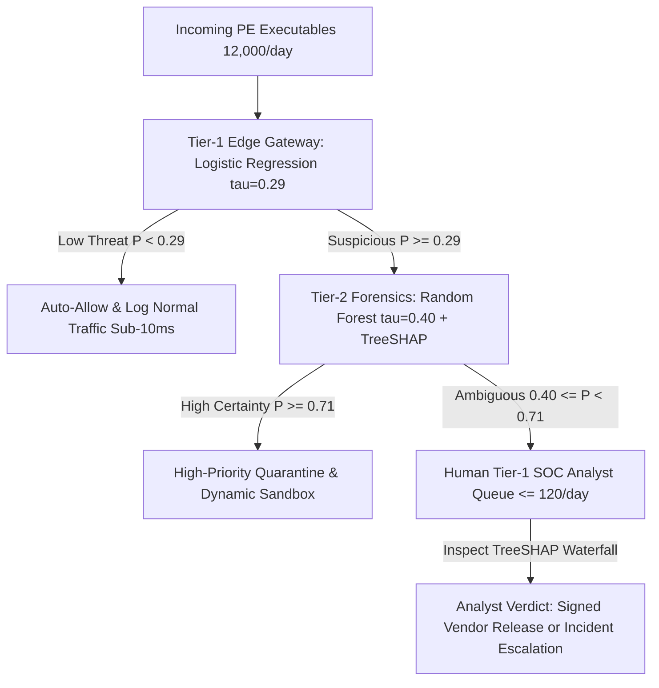

# 🛡️ Windows PE Static Malware Detection — SecMLOps, TreeSHAP & SOC Cost Optimization

[](https://www.python.org/)
[](https://scikit-learn.org/)
[](https://shap.readthedocs.io/)
[]()

> **Master in Intelligent Systems and Cyber Defense (MSSIC)**  
> **Module M115: AI & Intelligent Systems**  
> **Institution:** ENSIASD Taroudant — Ibn Zohr University  
> **Instructor:** Prof. Sara EL-ATEIF | **Academic Year:** 2026–2027  
> **Scenario:** AtlasPay Windows PE Malware Screening Incident (14 Sept 2026)

---

## 📌 Project Overview

This laboratory implements a defensive **SecMLOps static malware detection framework** on an **EMBER-inspired PE forensics dataset** (6,000 Portable Executables, 11 clean static features).

The scenario addresses the real-world operational challenge of **AtlasPay Services**, a Moroccan payment provider responding to a vendor software-update supply-chain alert:
1. **Forensic Audit & Anti-Parser Trapping:** Auditing data quality, detecting and replacing the sentinel parser bug `Virtual_to_Raw_Size_Ratio == 99999.0` with `NaN` for median imputation, eliminating uninformative identifiers (`SHA256_File_ID`), and stripping catastrophic post-scan target leakage (`VT_PostScan_Detections`).
2. **Leakage-Safe Multi-Model Benchmark (5-Fold CV):** Comparing 5 distinct candidate architectures using fold-isolated pipelines. Diagnosing severe overfitting on single decision trees ($\Delta F_1 = 0.1699$) and evaluating Bagging (`RandomForest`), Boosting (`HistGradientBoosting`), and Stacking.
3. **Perimeter Latency & Throughput Auditing:** Measuring millisecond-per-thousand-file scanning latency across held-out batches, identifying `LogisticRegression` (**8.20 ms / 1,000 files**, 121,886 files/s) as the edge throughput champion.
4. **Error Forensics & TreeSHAP (`shap.TreeExplainer`):** Investigating verified model disagreements (e.g., observation `5787` where LR failed due to benign-looking entropy $4.60$, while Random Forest detected the multi-condition stealth rule $Num\_Sections=9 \land Export\_Count=1$). Visualizing enterprise risk via Global Beeswarm and Local Waterfall decompositions.
5. **SOC Cost-Sensitive Threshold Optimization:** Calibrating decision thresholds on development Out-of-Fold (OOF) data under enterprise penalties ($C_{FP}=\$25, C_{FN}=\$500$) to freeze an optimal triage threshold ($\tau^* = 0.40$), and auditing the inline blocking scenario ($C_{FP}=\$2,000 \implies \tau^* = 0.71$).

---

## 📊 Benchmark Model Comparison

| Model Architecture | Train $F_1$ | Val $F_1$ | Overfitting Gap | Val PR-AUC | Latency (ms / 1k files) | Throughput (files/s) | Operational Verdict |
| :--- | :---: | :---: | :---: | :---: | :---: | :---: | :--- |
| **Logistic Regression** | 0.9231 | **0.9238** | **-0.0007** | **0.9080** | **8.20 ms** | **121,886** | ⭐ **Perimeter Gateway Champion** |
| **Decision Tree** | 1.0000 | 0.8301 | **0.1699** | 0.7330 | 8.50 ms | 117,647 | ❌ High Variance / Memorizes noise |
| **Random Forest** | 0.9999 | **0.9241** | 0.0758 | 0.9036 | 36.17 ms | 27,647 | ⭐ **Tier-2 Triage & XAI Champion** |
| **HistGradientBoosting** | 0.9800 | 0.9232 | 0.0568 | **0.9080** | 14.55 ms | 68,708 | ⭐ Fast Gradient Boosting |
| **Stacking Classifier** | 0.9929 | 0.9233 | 0.0696 | 0.9038 | 56.40 ms | 17,730 | ❌ Over-complex, 170x slower fit |

---

## 🛡️ Recommended AtlasPay SOC Tiered Architecture



---

## 📂 Repository Structure

```text
├── M115_Lab2_1.ipynb             # Fully solved notebook with outputs, TreeSHAP & markdown responses
├── Resume_Lab2_English.md        # Technical study guide & exercise breakdown in English
├── README_Lab2.md                # Project documentation and SOC architectural blueprint
└── README.md                     # Lab 1 & Lab 2 general repository overview
```

