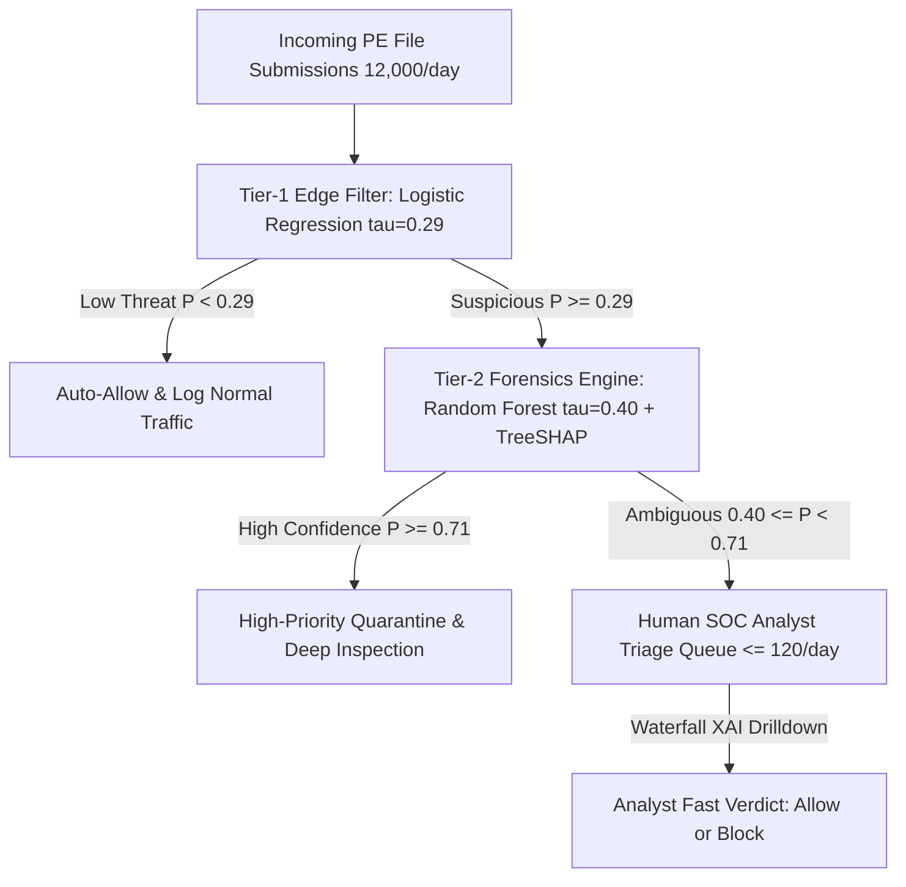

# 🛡️ Executive Lab 2 Study & Review Guide (English)
**M115: AI & Intelligent Systems — Master SSIC (Cyber Defense)**  
**ENSIASD Taroudant — Ibn Zohr University**  
**Scenario:** AtlasPay Windows PE Static Malware Detection Incident  
**Dataset:** EMBER-inspired Forensic Dataset (6,000 PE files, 11 Clean Features)

---

## 🧭 Executive Summary of All Lab Exercises

### 📍 PART 1: Forensic Data Audit & Trap Detection

#### 🔹 Exercise 1: SOC Target Alignment & Data Quality Audit
* **Class Imbalance:** 
  * Benign (`0`): **74.20%** (4,452 files)
  * Malware (`1`): **25.80%** (1,548 files)
  * *Operational Lesson:* Unlike balanced datasets, Accuracy is meaningless here. Primary metrics must be **F1-Score** and **PR-AUC (Precision-Recall Area Under Curve)**.
* **Missing Values Audit:**
  * `Resource_Entropy`: **~5% missing (~289 files)** due to CLI tools or minimalistic files lacking an `.rsrc` resource directory.
  * `Import_Count`: **~4% missing (~229 files)** due to corrupted PE headers or stripped Import Address Tables (IAT).
  * Clean zero-leakage resolution: Impute via median inside fold-safe pipelines (`SimpleImputer(strategy='median')`).

#### 🔹 Exercise 2: Corrupted Parser Sentinel & The Non-Linearity Trap
* **The `99999.0` Corrupted Ratio Trap:**
  * In `Virtual_to_Raw_Size_Ratio`, 59 records (0.98%) display `99999.0`.
  * *Root Cause:* The PE parser encountered `SizeOfRawData == 0` (division by zero) and defaulted to error code `99999.0`.
  * *SecMLOps Fix:* Replace `99999.0` with `np.nan` so median imputation replaces it with the robust baseline (`~1.13`) instead of distorting model weights.
* **Dual Malware Archetypes (Why Linear Boundaries Fail):**
  * **Archetype A (Classic Packed/Cryptor, ~65%):** High Section Entropy ($> 7.2$), low Import Count, low API imports, high RAM-to-disk ratio.
  * **Archetype B (Stealthy Living-off-the-Land, ~35%):** Normal/low Entropy ($4.0 - 5.5$), high Import Count, very high Suspicious APIs ($> 10$), often possessing valid digital signatures.
  * *Finding:* Benign software is sandwiched between Archetype A and Archetype B in feature space. A single linear hyperplane (`LogisticRegression`) cannot isolate both clusters without incurring massive False Positives or False Negatives. Tree-based ensembles (`RandomForest`, `HistGradientBoosting`) are strictly necessary.

#### 🔹 Exercise 3: Post-Scan Target Leakage & Feature Selection
* **Features Dropped:**
  1. `SHA256_File_ID`: Uninformative cryptographic hash. Causes memorization and overfitting.
  2. `VT_PostScan_Detections`: **Catastrophic Target Leakage.** Represents third-party multi-engine AV scan results available only post-incident in forensics labs, never at real-time perimeter gateways.
  3. `Is_Malware`: Extracted as target vector $y$.
* Remaining feature count: **11 clean static PE attributes**.

---

### 📍 PART 2: Leakage-Safe Evaluation Protocol & 5-Fold Cross-Validation

#### 🔹 Exercise 4: Candidate Benchmark & Variance Diagnosis
| Model | Train F1 | Val F1 | F1 Gap (Overfit) | Val PR-AUC | Fit Time (s) | Verdict |
| :--- | :---: | :---: | :---: | :---: | :---: | :--- |
| **Logistic Regression** | 0.9231 | **0.9238** | **-0.0007** | **0.9080** | **0.038s** | ⭐ **Linear Champion (Zero overfit, ultra-fast)** |
| **Decision Tree** | 1.0000 | 0.8301 | **0.1699** | 0.7330 | 0.085s | ❌ **Severe Overfitting / High Variance** |
| **Random Forest** | 0.9999 | **0.9241** | 0.0758 | 0.9036 | 1.242s | ⭐ **Bagging Champion (Peak Val F1)** |
| **HistGradientBoosting** | 0.9800 | 0.9232 | 0.0568 | **0.9080** | 0.755s | ⭐ **Boosting (Balanced, fast)** |
| **Stacking Classifier** | 0.9929 | 0.9233 | 0.0696 | 0.9038 | 6.780s | ❌ **Over-complex, 170x slower fit, no ROI** |

#### 🔹 Exercise 5: Perimeter Firewall Latency & Throughput Benchmark
* Tested across 25 iterations on 1,200 held-out test PE files:
| Model | Batch Time (ms) | Latency (ms / 1,000 files) | Throughput (files / sec) |
| :--- | :---: | :---: | :---: |
| **Logistic Regression** | **9.85 ms** | **8.20 ms** | **121,886 files/s** |
| **HistGradientBoosting** | 17.47 ms | 14.55 ms | 68,708 files/s |
| **Random Forest** | 43.40 ms | 36.17 ms | 27,647 files/s |

* *Operational Architecture Takeaway:* `Logistic Regression` achieves **14.8x higher throughput than Random Forest** while retaining virtually identical PR-AUC (0.9080 vs 0.9036).

#### 🔹 Decision Checkpoint 1: Shortlist Selection & Model Diagnosis
1. **Largest Train-Validation Gap:** `Decision Tree` exhibits $\Delta F_1 = 0.1699$ (Train $1.000$ vs. Val $0.8301$), diagnosing **severe overfitting and high variance**. It fits synthetic 4% label noise and individual sample outliers.
2. **Competitive Linear Baseline:** `Logistic Regression` is exceptionally strong ($F_1 = 0.9238$, PR-AUC $= 0.9080$, $\Delta F_1 = -0.0007$, fit time $0.038s$). Feature scaling and monotonic continuous signals allow the linear hyperplane to establish a robust boundary without overfitting.
3. **Random Forest vs. Single Tree:** Bagging 100 decorrelated trees provides an immediate **+9.4% F1 surge** (from $0.8301$ to $0.9241$), successfully neutralizing tree variance.
4. **HistGradientBoosting Justification:** Fast training ($0.755s$, 40% faster than RF) and solid PR-AUC ($0.9080$).
5. **Stacking Rejection:** Rejected due to extreme fit latency ($6.78s$, over 170x slower than LR) with zero marginal performance gain ($F_1 = 0.9233$). Unviable for AtlasPay's high-volume throughput requirements.
* **Shortlisted Candidates:**
  * **Candidate 1 (Linear/Edge):** `Logistic Regression` (Perimeter throughput champion).
  * **Candidate 2 (Tree/Non-Linear):** `Random Forest` (Peak F1 score for deeper error forensics).

---

### 📍 PART 3: Error Forensics & TreeSHAP Explainability

#### 🔹 Exercise 6: Real Model Disagreement Investigation (Observation Index: 5787)
* **Ground Truth:** `y_true = 1` (**MALWARE** — Archetype B: Stealthy Living-off-the-Land).
* **Model Predictions at $\tau = 0.50$:**
  * **Logistic Regression:** $P(\text{Malware}) = \mathbf{0.3044} \implies \text{BENIGN}$ (❌ **False Negative / Missed Attack**).
  * **Random Forest:** $P(\text{Malware}) = \mathbf{0.5300} \implies \text{MALWARE}$ (✅ **True Positive / Detected Attack**).
* **Forensic Feature Breakdown of Observation 5787:**
  * `Max_Section_Entropy = 4.60` (Low/benign-like, no packing).
  * `Import_Count = 116.69` (High import count mimicking legitimate software).
  * `Suspicious_API_Imports = 3.0` (Modest API count).
  * `Has_Valid_Signature = 0` (Unsigned).
  * `Num_Sections = 9.0` (Abnormally high section count).
  * `Export_Count = 1.0` (Single export characteristic of injection DLLs).
* **Why Logistic Regression Failed:** Because the linear sum ($\sum w_j x_j$) was overwhelmed by benign-like features (low entropy + high import count), pulling log-odds well below the zero decision boundary.
* **Why Random Forest Succeeded:** Decision trees partition feature space non-linearly. The ensemble identified the specific multi-condition rule: $\text{IF } (\text{Has\_Valid\_Signature} == 0) \land (\text{Num\_Sections} \ge 8) \land (\text{Export\_Count} \le 1) \implies \text{MALWARE}$.

#### 🔹 Exercise 7: Global & Local TreeSHAP (`shap.TreeExplainer`)
* **Global Beeswarm Plot:** Quantifies risk drivers across the enterprise:
  * High `Max_Section_Entropy` (red dots) strongly pushes SHAP values $> 0$ toward Malware.
  * High `Suspicious_API_Imports` similarly drives high positive threat attribution.
  * Valid signatures and clean import counts drive SHAP values $< 0$ toward Benign.
* **Local Waterfall Plot (File 5787):** Decomposes $f(x) = E[f(X)] + \sum \phi_j(x)$:
  * Base rate: $E[f(X)] \approx 0.26$.
  * Downward pushes ($-f(x)$): `Max_Section_Entropy = 4.60` and `Import_Count = 116.69`.
  * Dominant upward threat pushes ($+f(x)$): `Has_Valid_Signature = 0`, `Num_Sections = 9`, and `Export_Count = 1` successfully drove final probability to $\mathbf{0.53}$.
* **Philosophical Security Caveat (SHAP $\ne$ Causality):** SHAP explains **model internal representations and statistical associations**, not physical root-cause malware execution. High section count correlated with malware in training, but does not physically "cause" malicious execution. Human reverse engineering remains mandatory.

---

### 📍 PART 4: SOC Cost Optimization & Decision Threshold Tuning

#### 🔹 Exercise 8: Cost Matrix Formulation & OOF Optimization
* **Enterprise Planning Penalties:**
  * Analyst Triage Mode: $C_{FP} = \$25$ (analyst time/friction), $C_{FN} = \$500$ (breach remediation).
  * Automated Inline Blocking Mode: $C_{FP} = \$2,000$ (disruption of merchant payment processing), $C_{FN} = \$500$.
* **Leakage-Safe OOF Tuning Protocol:** Thresholds optimized strictly using Out-Of-Fold development predictions (`cross_val_predict(..., method='predict_proba')`) and frozen:
  * $\tau^*_{\text{triage}} = \mathbf{0.40}$ (Random Forest) / $\tau^* = \mathbf{0.29}$ (Logistic Regression).
  * $\tau^*_{\text{inline\_block}} = \mathbf{0.71}$ (Random Forest shifts right to prevent catastrophic $2,000 false alarms).

#### 🔹 Exercise 9: Frozen Evaluation on Lockbox Test Set ($N=1,200$)
| Operating Scenario | Frozen $\tau$ | TP | FP (False Alarms) | FN (Missed) | Precision | Recall | $F_1$-Score | Total Enterprise Cost ($) | Alert Rate (%) |
| :--- | :---: | :---: | :---: | :---: | :---: | :---: | :---: | :---: | :---: |
| **Analyst Triage (Default)** | **0.40** | **287** | **9** | **35** | **96.96%** | **89.13%** | **0.9288** | **\$17,725** | **24.67%** |
| Standard Baseline | 0.50 | 287 | 9 | 35 | 96.96% | 89.13% | 0.9288 | \$17,725 | 24.67% |
| Inline Blocking ($C_{FP}=\$2k$) | 0.71 | 282 | 8 | 40 | 97.24% | 87.58% | 0.9216 | \$36,000 | 24.17% |

* *Capacity Feasibility Warning:* The test alert rate (24.67%) on 12,000 files/day would produce **~2,960 alerts/day**, saturating AtlasPay's 6 analysts (capacity: 120/day). This discrepancy stems from the synthetic 26.8% malware prevalence vs. real-world enterprise rates ($\le 0.1\%$). Re-calibration with live telemetry is mandatory prior to deployment.

---

### 📍 PART 5: Final Architecture Decision & CISO Recommendation

#### 🛡️ CISO Executive Synthesis:
1. **Deployment Architecture:** Deploy a two-stage hybrid pipeline: ultra-fast `Logistic Regression` at the perimeter gateway to filter 95%+ of obvious benign traffic with sub-10ms latency, followed by `Random Forest` at Tier-2 for granular non-linear scoring.
2. **Initial Operating Mode:** Decision-support triage ($\tau = 0.40$). Autonomous blocking ($\tau = 0.71$) must remain disabled until production false-alarm telemetry proves zero payment disruption.
3. **Auditability:** Mandate TreeSHAP waterfall generation for every escalated alert to accelerate analyst triage from 15 minutes to under 2 minutes.

